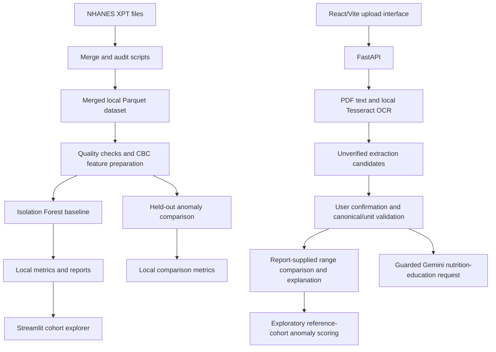
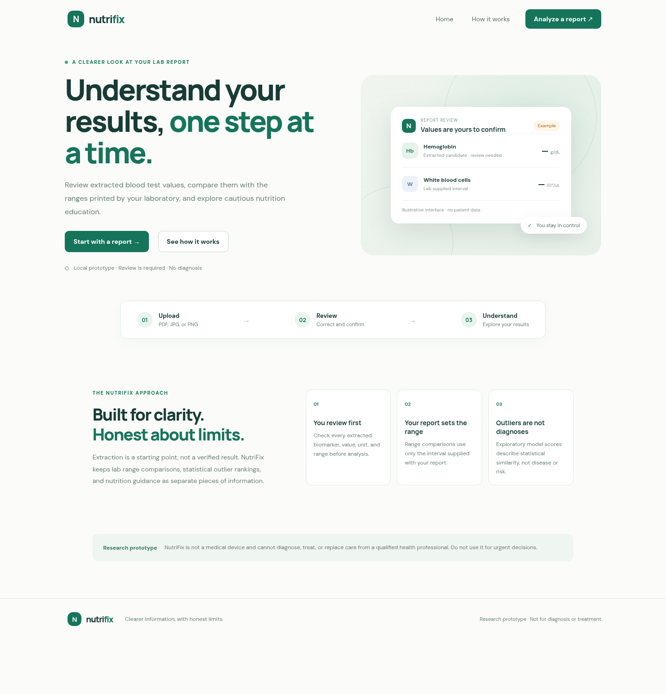
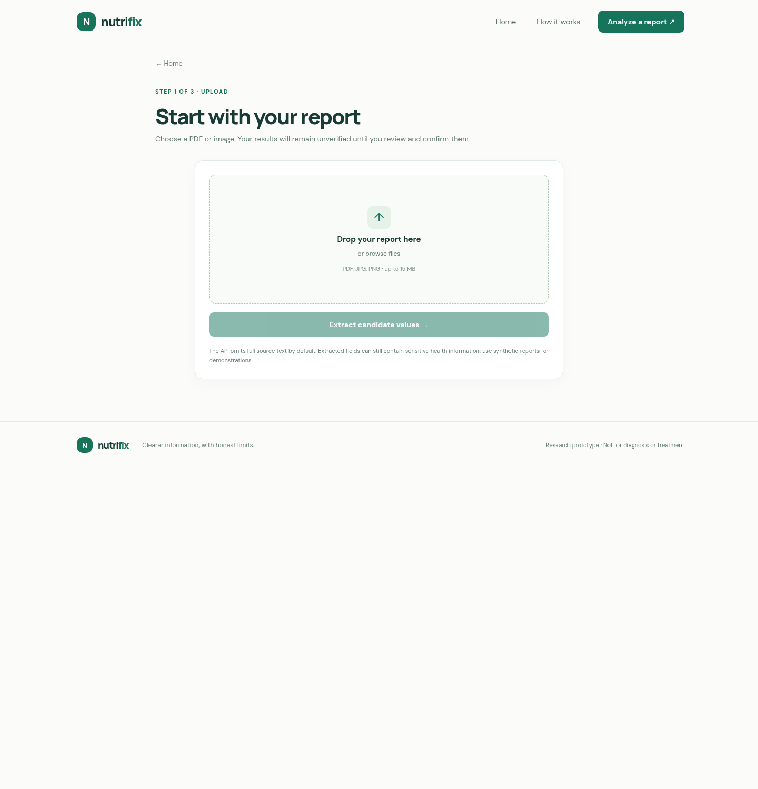
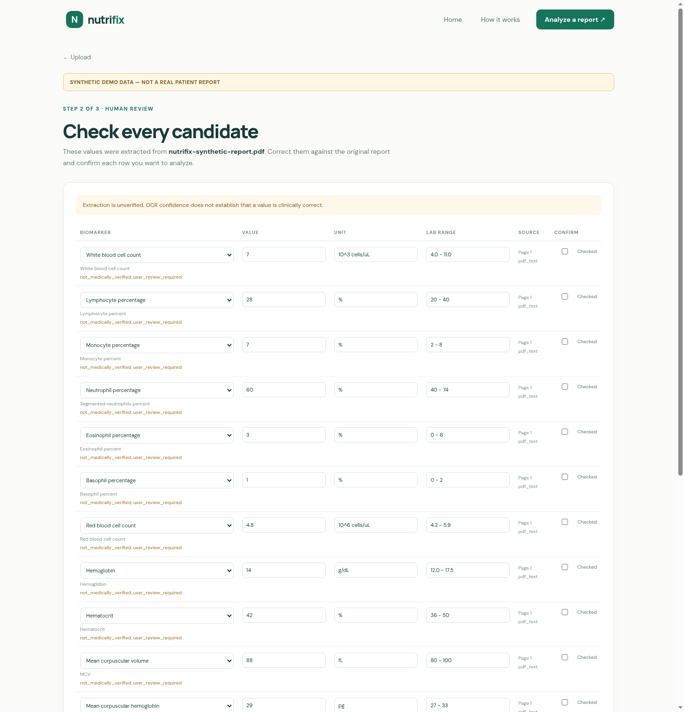
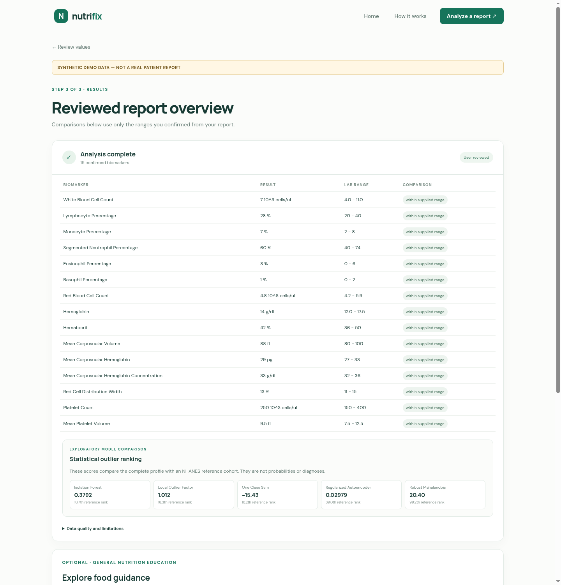
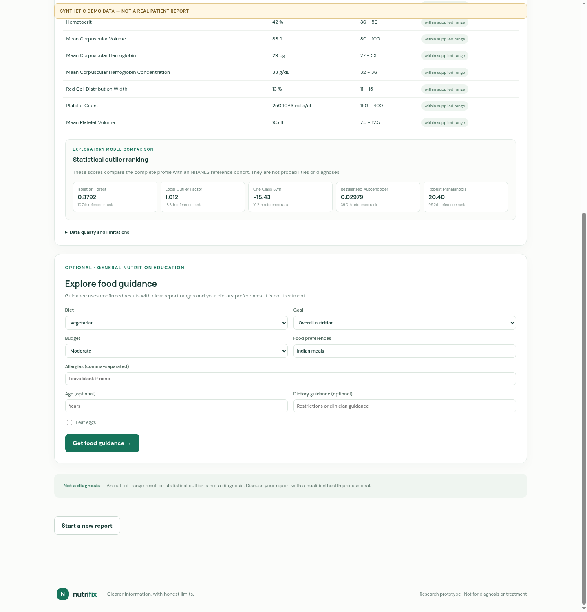
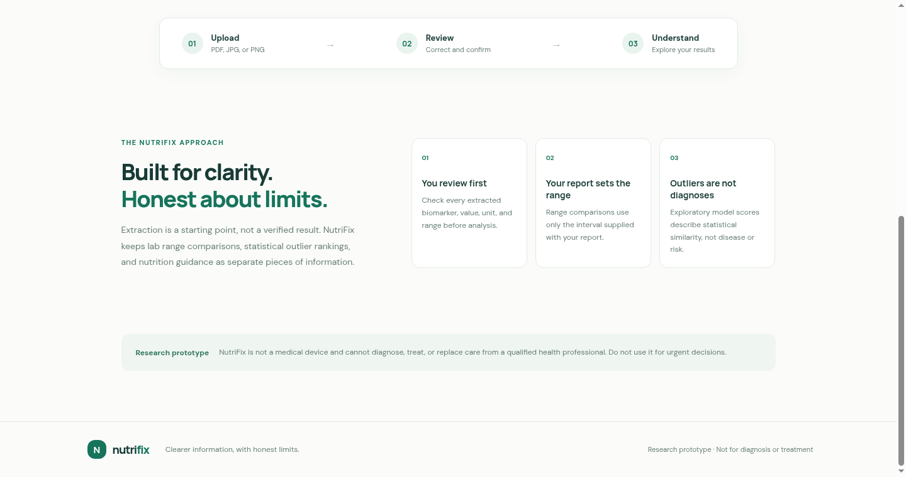
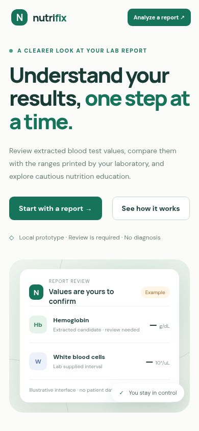

# NutriFix

### AI-Powered Blood Report Analysis & Personalized Diet Recommendations

NutriFix is a research prototype for extracting a small set of values from supported blood-report formats, exploring CBC data statistically, and returning general nutrition education from structured inputs. It is not a medical device or a clinically validated diagnostic system.

## What is implemented

- A FastAPI service with local text/OCR extraction, a strict user-confirmed report-analysis contract, report-supplied interval comparisons, and a guarded AI nutrition-education endpoint.
- A React/Vite interface with upload, editable extraction review, explicit confirmation, report-range analysis, exploratory score display, and optional nutrition education.
- A separate Streamlit explorer for the NHANES cohort and the existing Isolation Forest outputs.
- Scripts to verify downloaded files, merge NHANES 2017–2018 CBC, demographics, and ferritin data, audit data quality, prepare CBC features, and run an Isolation Forest baseline.
- Exploratory anomaly explanations, participant reports, and sensitivity checks.
- A held-out comparison script for Isolation Forest, novelty Local Outlier Factor, regularized robust Mahalanobis distance, One-Class SVM, and a regularized autoencoder. Its rankings are exploratory and have not been clinically validated.

### OCR status

The API uses local Tesseract OCR for scanned PDF pages and JPEG/PNG images, and PyMuPDF for PDF text and page rendering. It first extracts selectable PDF text, then OCRs low-text pages. Uploads are limited to 15 MB and 100 PDF pages; at most 30 pages are OCRed, with 30-second per-call and 120-second total OCR limits. Two local processing slots are available; excess work receives a retryable response. Supported labels are matched conservatively against `schemas/canonical_biomarkers.json`; unknown or ambiguous numeric lines remain unresolved. Extracted values retain page/line provenance and OCR confidence, are marked unverified, and require human review. Units are not converted and clinical intervals are not invented. This is a prototype parser, not a universal laboratory-report parser. Tesseract 5 with English and orientation data must be installed on the host.

### Nutrition guidance status

The recommendation endpoint calls the Google Gemini API when configured. It is intended for general nutrition education. The project does not connect a curated medical evidence database, does not provide validated personalized treatment advice, and must not be used to diagnose or treat disease.

## Architecture and data flow



The API/UI path and the NHANES cohort-analysis path are separate. The comparison script reads the merged local dataset directly and writes its outputs under `outputs/metrics/`; it does not replace the report API. The frontend supports upload → editable candidate review → explicit confirmation → analysis → optional nutrition education. A Vite development proxy forwards `/api` to the local FastAPI service. Report analysis compares values only with ranges supplied in the report and can show exploratory model rankings when all 15 required CBC features are confirmed and the local scoring bundle is available.

## Application screenshots

The review and results screenshots use a clearly labeled synthetic PDF created for the local browser check. It contains no real patient data. The recommendation screenshot shows the input form; a Gemini response was not generated for the screenshots.

| Screen | Preview |
| --- | --- |
| Landing page |  |
| Upload |  |
| Extraction review |  |
| Results |  |
| Nutrition guidance form |  |
| Methodology |  |
| Mobile layout |  |

## Repository layout

```text
NutriFix/
├── api.py                         # FastAPI endpoints
├── app.py                         # Streamlit NHANES explorer
├── food_recommendations.py        # Gemini-backed education response
├── frontend/                      # React and Vite client
├── schemas/                       # Canonical biomarker definitions
├── scripts/                       # Download, merge, audit, and model commands
├── src/nutrifix/                  # Data and model implementation
├── tests/                          # Unit tests
├── data/                           # Local-only source and processed datasets
└── outputs/                        # Local-only audits, metrics, and reports
```

`data/` and `outputs/` are intentionally excluded from Git. The source code expects those paths to exist locally when running the data workflows.

## Technology

- Python 3.12, pandas, NumPy, scikit-learn, SciPy, and PyArrow
- FastAPI, Pydantic, Uvicorn, PyMuPDF, Pillow, and system Tesseract OCR
- Google Gen AI SDK with an optional Gemini API key
- Streamlit for cohort exploration
- React, Vite, and npm for the upload interface

The Python versions in `requirements.txt` match the available project `mlenv` environment at checkpoint preparation. OCR also requires the Tesseract executable and `eng`/`osd` language data; Python dependencies alone do not install it. The frontend versions are locked in `frontend/package-lock.json`.

## Garuda Linux / Linux setup

For the existing Garuda development environment:

```bash
conda activate mlenv
```

For a fresh environment:

```bash
conda create -n nutrifix python=3.12
conda activate nutrifix
```

Then install the pinned Python dependencies:

```bash
python -m pip install -r requirements.txt
cp .env.example .env
```

Install the system Tesseract package and its English/orientation data with Garuda's package manager before using scanned reports. No Python package installs Tesseract.

Set `GEMINI_API_KEY` in `.env` only if you intend to call the recommendation endpoint. Never commit `.env`. The API defaults to the model name configured in `GEMINI_MODEL` or `gemini-2.5-flash`.

For the frontend, use a Node version satisfying Vite's lockfile requirement (`^20.19.0` or `>=22.12.0`), then run:

```bash
cd frontend
npm ci
npm run dev
```

The Vite dev server proxies `/api` to the local API. In another terminal, from the project root with the Python environment activated, start FastAPI:

```bash
uvicorn api:app --reload --host 127.0.0.1 --port 8000
```

Open the Vite address printed by `npm run dev`. Report extraction and analysis run locally. Optional nutrition recommendations send confirmed structured biomarker values and dietary preferences to Google Gemini when configured; they are not available offline.

The FastAPI health endpoint is `/api/health`; interactive API documentation is provided by FastAPI at `/docs` while the local service is running.

## NHANES data and cohort explorer

The project uses the 2017–2018 NHANES CBC (`CBC_J.xpt`), demographics (`DEMO_J.xpt`), and ferritin (`FERTIN_J.xpt`) public-use files. Download the files and their documentation from the official [NHANES 2017–2018 data page](https://wwwn.cdc.gov/nchs/nhanes/search/DataPage.aspx?Cycle=2017-2018), [CBC_J codebook](https://wwwn.cdc.gov/Nchs/Data/Nhanes/Public/2017/DataFiles/CBC_J.htm), [DEMO_J codebook](https://wwwn.cdc.gov/Nchs/Data/Nhanes/Public/2017/DataFiles/DEMO_J.htm), and [FERTIN_J codebook](https://wwwn.cdc.gov/Nchs/Data/Nhanes/Public/2017/DataFiles/FERTIN_J.htm). Review component-specific eligibility, missingness, and analytic notes before interpreting results.

Place the three files here:

```text
data/raw/nhanes/2017_2018/CBC_J.xpt
data/raw/nhanes/2017_2018/DEMO_J.xpt
data/raw/nhanes/2017_2018/FERTIN_J.xpt
```

Then run the existing workflow from the project root:

```bash
python scripts/verify_downloads.py
python scripts/merge_nhanes.py
python scripts/run_pipeline.py
python -m src.nutrifix.explain_anomalies
python -m src.nutrifix.participant_report
streamlit run app.py
```

`run_pipeline.py` performs quality checks, feature preparation, and Isolation Forest scoring; merging is a separate step. The Streamlit explorer also needs the explanation and participant-report files generated by the two module commands above.

To run the separate held-out comparison, use a fresh output directory each time. The script refuses to overwrite an existing experiment directory:

```bash
python scripts/compare_anomaly_models.py \
  --output-dir outputs/metrics/anomaly_model_comparison_run_01
```

## Tests

The model-comparison, report-extraction, and API workflow tests use Python's standard library test runner (OCR tests require local Tesseract):

```bash
python -m unittest discover -s tests -v
```

Last verified on 2026-10-28 in `mlenv`: 42 tests passed. Tests use synthetic uploads, an in-memory synthetic cohort for model fitting, and mocked recommendation responses; they do not call Gemini. A separate local browser check used a labeled synthetic CBC PDF through upload, review, and analysis, and verified five model scores. These checks do not establish clinical or OCR accuracy. `scripts/test_pipeline_outputs.py` is a separate output-check script and requires the generated baseline prediction, explanation, and report files to be present.

## Anomaly-detection limitations

The original Isolation Forest baseline uses CBC measurements and missingness indicators. Its earlier cohort-level preprocessing fitted medians and scaling on the full cohort; its outputs are exploratory and are not a held-out clinical evaluation. The separate comparison script evaluates five methods on a seeded reference/test split and also compares preprocessing with and without missingness indicators. One split does not establish generalization. Agreement, ranking stability, or a selected fraction of candidates is not evidence of diagnostic accuracy. No validated clinical labels are included.

The report API compares values only with intervals supplied by the user from their report; it does not provide clinical reference-range rules. The canonical schema provides biomarker names and units, but the repository does not provide sourced, population-applicable reference intervals. Such a baseline needs authoritative interval sources and relevant age, sex, pregnancy, assay, and specimen context before implementation.

## Privacy and safe use

- Do not commit `.env`, API keys, health reports, patient data, raw datasets, merged datasets, or generated participant-level outputs. Root `.gitignore` excludes these paths and file types by default.
- NHANES is public-use survey data, but local merged data and reports contain participant-level biomarker and demographic fields and should remain local unless deliberately reviewed.
- The API reads uploaded content into memory for processing. If the recommendations endpoint is called, the supplied structured biomarkers and preferences are sent to Google's Gemini API; review the provider's terms and your privacy obligations before using real reports.
- Treat extracted values and supplied ranges as unverified inputs. The API's parser supports only a narrow set of text patterns and does not validate clinical correctness.
- The API has no user accounts, report persistence, or access-control layer. Run it locally only. Full extracted text, page lines, and unresolved source lines are omitted from responses by default; `include_source_text=true` explicitly opts into returning them for audit. Candidate biomarker rows retain field-level source snippets. Do not expose the service publicly or send real reports until access control and privacy handling are designed.
- Analysis and recommendation requests require `reviewed_by_user: true` for each marker. The frontend provides an editable review step, but this client confirmation signal is not proof that a person independently verified the value.
- Complete user-reviewed CBC profiles can be scored against a locally built NHANES 2017–2018 reference bundle using the five exploratory models. Every model requires all 15 selected features in their canonical units; incomplete profiles receive `insufficient_data`. Scores are outlier rankings, not probabilities, diagnoses, or medical advice. The held-out calibration participants provide only an empirical comparison distribution, not labeled normal or disease examples.
- Build the local reference bundle with `python scripts/build_report_scoring_model.py`. It writes to `outputs/models/report_scoring_v1/` and refuses to overwrite an existing directory. Choose another path with `--output-dir` for a new run. The ignored model artifact is local and must be rebuilt from the NHANES parquet dataset on another machine.
- The individual scoring bundle stores model and preprocessing parameters plus held-out score distributions, but no NHANES participant IDs. It uses the same seeded 75/25 reference/calibration split and training-only preprocessing as the cohort comparison. Profiles with any missing model feature are not scored.
- NutriFix is a research prototype. It is not a substitute for a clinician, laboratory, or validated medical device. Do not use it for diagnosis, treatment, or urgent-care decisions.

## Roadmap

- Add UI-level automated browser tests for file upload, candidate correction, analysis errors, and recommendation-service failures.
- Expand and evaluate OCR/parser coverage on a manually verified, appropriately deidentified corpus before reporting accuracy metrics.
- Source and review clinically applicable reference intervals before adding a clinical-rules baseline.
- Evaluate anomaly methods on appropriate labeled or clinician-reviewed data before making clinical claims.
- Improve report-format coverage, privacy controls, and documented validation before any real-world clinical use.
